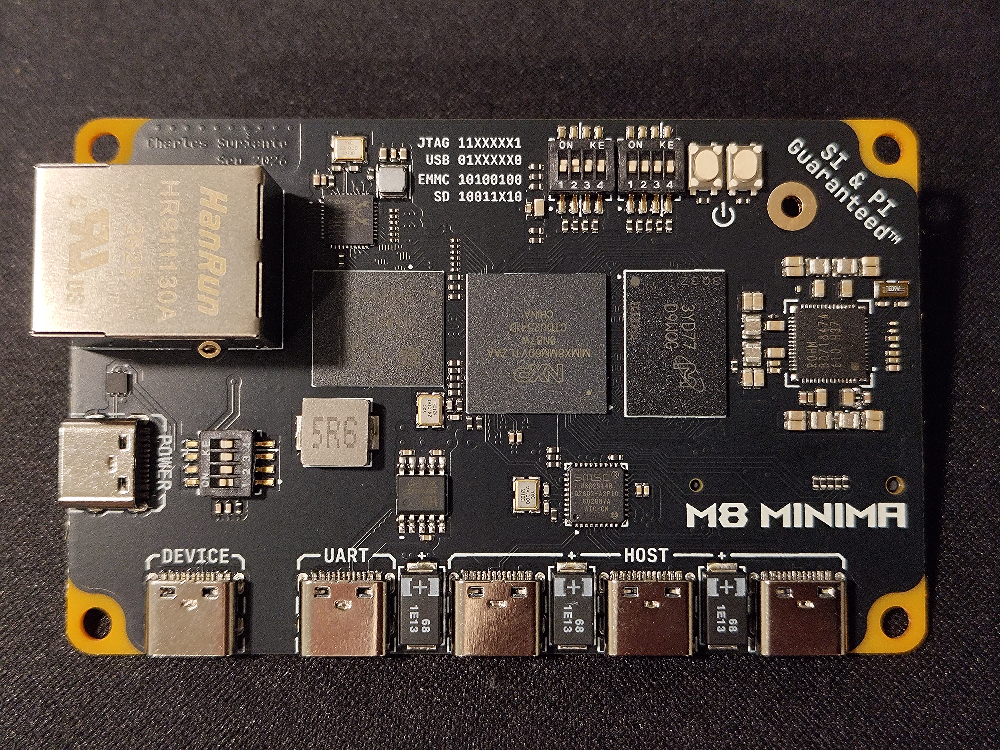
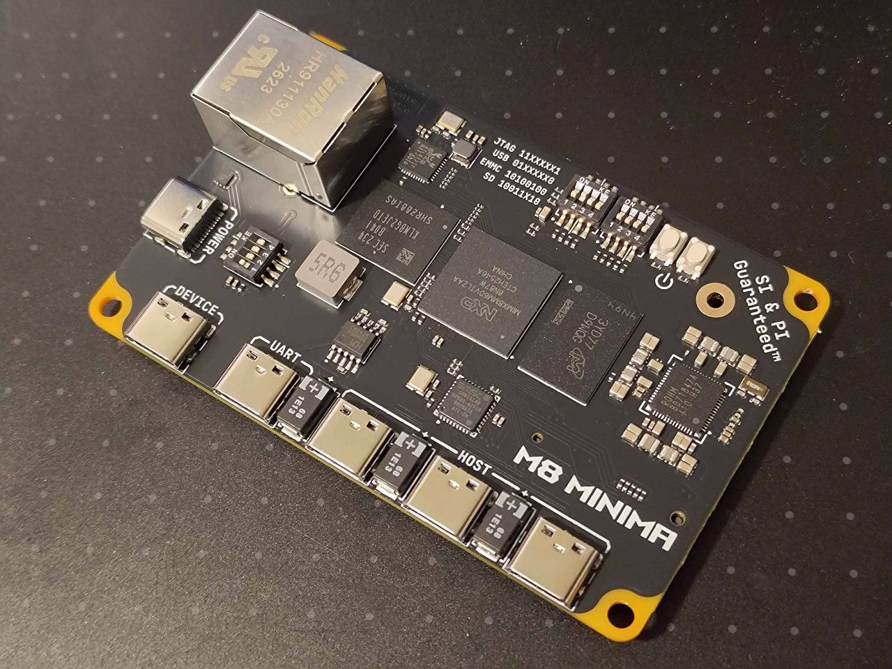
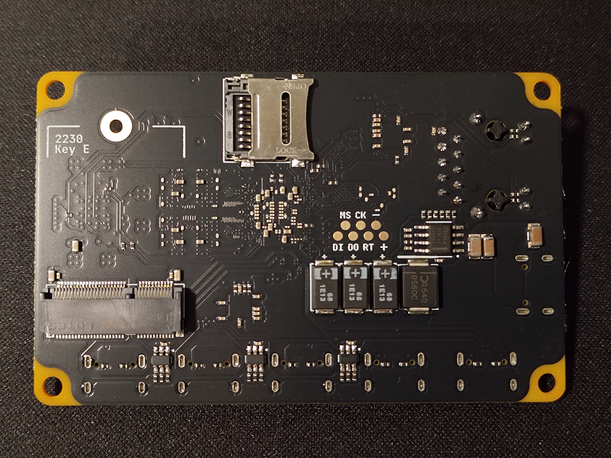
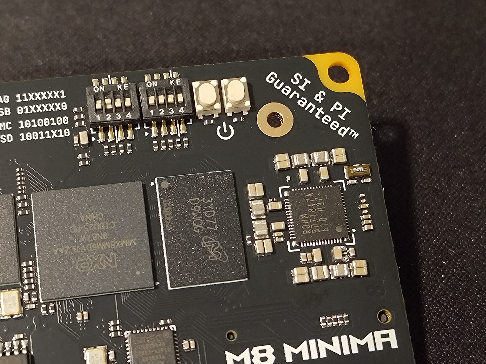

# M8 Minima

<p align="center">
    
</p>

A minimalistic single-board computer built around NXP's IMX8M Mini.

Start with the [Bring-Up Runbook](docs/notes/M8%20Minima%20Bring-Up%20Runbook.md):
it covers bring-up status, host setup, building, flashing and known issues.

[Gallery](#gallery) below.

## Hardware

| Path | What |
| --- | --- |
| [`hardware/M8 Minima/`](hardware/M8%20Minima/) | Altium Designer project (`M8 Minima.PrjPcb`) |
| [`hardware/M8 Minima/main.PcbDoc`](hardware/M8%20Minima/main.PcbDoc) | Board layout; `panel.PcbDoc` is the panelized version |
| `hardware/M8 Minima/*.SchDoc` | Schematic sheets, numbered `01 top` to `12 uart`, plus `A1 power map` |
| [`hardware/M8 Minima/M8 Minima.stackup`](hardware/M8%20Minima/M8%20Minima.stackup) | Layer stackup |
| [`docs/schematic.pdf`](docs/schematic.pdf) | Schematic export |
| [`docs/MIMX8MM6xxxLZ.mex`](docs/MIMX8MM6xxxLZ.mex) | Pin mux (MCUXpresso Config Tools), the source of truth for pin assignments |

## Docs

| Path | What |
| --- | --- |
| [`docs/notes/M8 Minima Bring-Up Runbook.md`](docs/notes/M8%20Minima%20Bring-Up%20Runbook.md) | Bring-up status, setup, build and flash steps, known issues |
| [`docs/notes/design review.xlsx`](docs/notes/design%20review.xlsx) | Design review checklist |
| [`docs/references/`](docs/references/) | Datasheets and app notes: i.MX8MM, BD71847 PMIC, RTL8211F PHY, USB2514 hub, CH342 UART, TPS2553 |

## BSP and software

| Path | What |
| --- | --- |
| [`bsp/modules/`](bsp/modules/) | U-Boot, TF-A and Linux changes as overlays on pinned upstream commits ([README](bsp/modules/README.md)) |
| [`bsp/kernel/m8-minima.config`](bsp/kernel/m8-minima.config) | Kernel config fragment merged over `imx_v8_defconfig` |
| [`bsp/ddr/`](bsp/ddr/) | LPDDR4 calibration: RPA `.ds` script, `lpddr4_timing.c`, mscale log |
| [`bsp/flash.bin`](bsp/flash.bin) | Latest packaged bootloader |
| [`bsp/emmc-bootloader.uuu`](bsp/emmc-bootloader.uuu) | uuu script: write `flash.bin` to eMMC `boot0` |
| [`bsp/ram-boot/`](bsp/ram-boot/) | uuu script to boot a kernel from RAM over USB |

`uuu.exe` and the mscale DDR tool aren't in git; the runbook's one-time setup
says where to download them.

## Scripts

Run inside WSL; see the runbook for setup.

| Script | What |
| --- | --- |
| [`build-m8-minima.sh`](scripts/build-m8-minima.sh) | One-shot build: fetch sources, TF-A, U-Boot, `flash.bin`, kernel |
| [`fetch-sources-m8-minima.sh`](scripts/fetch-sources-m8-minima.sh) | Clone upstream repos at their base commits and apply `bsp/modules/` |
| [`package-m8-minima.sh`](scripts/package-m8-minima.sh) | Build U-Boot and package `flash.bin` |
| [`build-kernel-m8-minima.sh`](scripts/build-kernel-m8-minima.sh) | Build kernel `Image`, modules and board DTB |
| [`build-sdcard-m8-minima.sh`](scripts/build-sdcard-m8-minima.sh) | Build the Debian SD card image (run with sudo) |

```sh
REPO="/mnt/c/My Drive/Ender Folder/Projects/crls design/M8 Minima"
tr -d '\r' < "$REPO/scripts/build-m8-minima.sh" | bash
```

## Gallery



| Front | Back |
| --- | --- |
|  |  |
| i.MX8M Mini with LPDDR4 and eMMC, BD71847 PMIC, USB2514 hub, Gigabit Ethernet, and USB-C ports: power, device, UART, and three hosts | microSD slot, M.2 2230 Key E slot, and JTAG pads |


